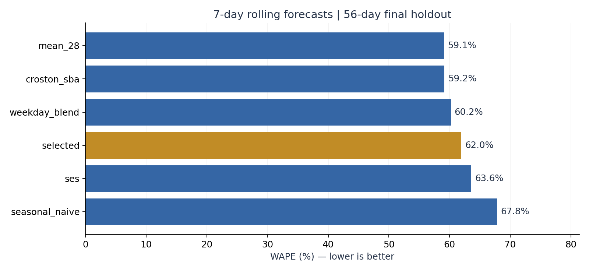

# 供应链计划算法实验室

**从发货需求预测，到分层补货，再到首印和有限产能分配。**

这是从出版发行计划场景出发构建的三个可复现实验，适合展示供应链计划、数据产品和经营分析能力。项目在 AI 编程工具辅助下实现；业务问题、指标口径、实验边界与结果解释均应由作者理解并负责。


> **数据与成果边界**：曾使用作者电脑上的历史发货与首发规划材料进行本地验证；公开仓库仅包含独立生成的合成数据和对应实验结果。真实记录、商品身份、客户、员工、订单、价格、成本及真实数据回测结果均不随仓库发布。本项目于 2026 年 10 月新增，是算法作品与离线实验，不代表历史任职期间已部署的系统或已实现的业务收益。

## 三个项目

| 项目 | 业务问题 | 算法与实验 | 主要输出 |
|---|---|---|---|
| [01 商品需求预测](projects/01-demand-forecasting/README.md) | 长尾、间歇和波动需求怎样预测？ | 周季节朴素、28 日均值、SES、Croston-SBA、星期结构融合；按时间验证选模 | 逐条预测、模型选择记录、WAPE/Bias/MASE |
| [02 ABC/XYZ 分层补货](projects/02-inventory-replenishment/README.md) | 服务水平与库存投入怎样权衡？ | ABC/XYZ、定期复核订货、批量取整、丢失销售仿真、交期与缺货惩罚敏感性 | 补货流水、库存守恒、满足率、成本与在途库存 |
| [03 首印与产能分配](projects/03-print-capacity-planning/README.md) | 滞销风险、缺货风险与有限产能怎样平衡？ | 年度趋势融合、经验分位数报童模型、整数批量 MILP、贪心基线 | 回测损失、计划印量、缺口、产能约束与求解间隙 |

三个实验使用共享数据契约，各自验证。补货仿真与生产优化尚未联成带真实库存反馈的执行系统。

## 立即运行

在 Python 3.11+ 环境中，从仓库根目录执行：

```bash
python -m venv .venv
# Windows: .venv\Scripts\activate
# macOS/Linux: source .venv/bin/activate
python -m pip install -e ".[dev]"
python -m supplychain demo
python -m pytest -q
python scripts/privacy_check.py
```

演示包含 **48 个商品 × 420 天**的日需求，以及 **72 个规划商品 × 5 年**的年度历史。四类需求由生成器预设：常规、趋势、间歇、低频大批量；不从私有数据复制、缩放、打乱或改名得到。所有提前期、批量、成本、期初库存与产能均为情景假设。

[查看完整实验结果](reports/demo/RESULTS.md) · [方法与公式](docs/METHODS.md) · [数据契约](docs/DATA_CONTRACT.md) · [隐私与来源](docs/PRIVACY.md) · [面试说明](docs/INTERVIEW.md)

## 结果应怎样读

固定种子 `20261017` 的合成数据实验中，选模策略 WAPE 为 **61.96%**，周季节朴素基线为 **67.82%**；28 日均值为 **59.10%**。这说明按商品选模并不自动优于简单的统一方法；短验证窗口和需求漂移会影响泛化。

库存实验中，分层预测策略满足率 **98.41%**，统一 95% 参数策略为 **98.44%**，且后者测算成本更低。名义服务参数与实际满足率不是同一指标；算法应根据成本与服务目标选择。

在 75% 印量产能情景下，MILP 目标值为 **61,347.8**，可行贪心基线为 **64,999.6**，均采用相同批量、起印量、成本和产能约束。目标值是模型成本单位，不是实际货币节省；100% 产能时两种方法得到相同目标值。



## 数据流与实验纪律

```text
标准化日发货量 ── 时间验证选模 ── 7 日滚动回测 ── 固定历史模型选择
                     │
                     └── ABC/XYZ + 复核周期 + 情景交期 ── 库存策略仿真

历年关联商品实销 ── 年度回测与经验报童分位数
               └── 下一期点预测 + 情景产能/起印量 ── MILP 与可行贪心对比
```

- 日模型在最终测试期之前的 42 天选择；最终 56 天切成 8 个互不重叠的 7 天预测窗口。
- 测试期不改变模型选择，参数会使用每个预测时点以前的观测重新估计。
- 实际发货量受历史库存限制，是已履约需求的代理；没有缺货日志就无法恢复被压抑的需求。
- 负净实销可能是退货，不能直接作为负需求，也不能自动视为可再次销售的库存。
- 年度历史只有五个观测，限定使用简单趋势和先前年度残差池；过量计划仅用于刻画滞销敞口，不能直接解释为实际退货。
- 仿真输出保留期末库存和在途量；测算成本不含采购付款和期末库存残值，不能解释为利润。
- 原始导出有日期缺口时先查采集完整性，不能默认补零。

## 使用自己的私有数据

按[数据契约](docs/DATA_CONTRACT.md)准备三个 CSV，放在仓库外。命令拒绝把私有模式结果写入仓库：

```bash
python -m supplychain evaluate --data-dir ../private-data --output ../private-results
```

该接口不会自动读取本机文件、浏览器、ERP 或任何密钥。真实数据仅在用户明确提供的本地路径读取。上传前执行隐私扫描；原始 Excel、身份映射和本地验证材料应保存在独立目录。

## 工程结构

```text
supplychain/       数据契约、预测、补货仿真、报童模型、MILP、实验入口
projects/          三个项目的业务定义和验收指标
data/demo/         独立合成 CSV 与种子、哈希清单
reports/demo/      可复现的预测、仿真、排产结果与图表
docs/              公式、数据边界、隐私和面试说明
tests/             时间穿越、库存守恒、穷举最优解、约束与数据契约测试
scripts/           隐私和发布边界检查
.github/workflows/ 自动测试、演示复算与隐私检查
```

`requirements-lock.txt` 记录作者验证时的直接依赖版本，`pyproject.toml` 给出支持范围。公开演示数据与指标可重算；PNG 文件的字节可能随 Matplotlib/字体版本变化。

## 方法参考

- Hyndman & Athanasopoulos：[Forecasting: Principles and Practice，时序验证与预测评估](https://otexts.com/fpp3/toolbox.html)。
- Syntetos & Boylan (2005)：[The accuracy of intermittent demand estimates](https://doi.org/10.1016/j.ijforecast.2004.10.001)。
- SciPy：[混合整数线性规划接口 `scipy.optimize.milp`](https://docs.scipy.org/doc/scipy/reference/generated/scipy.optimize.milp.html)。

实现是针对本项目简化场景的独立代码，不构成对所引方法在所有需求形态下的性能保证。

## License

代码与独立合成数据使用 [MIT License](LICENSE)。不包含原业务系统、ERP 导出、品牌素材或第三方业务资料的许可。
