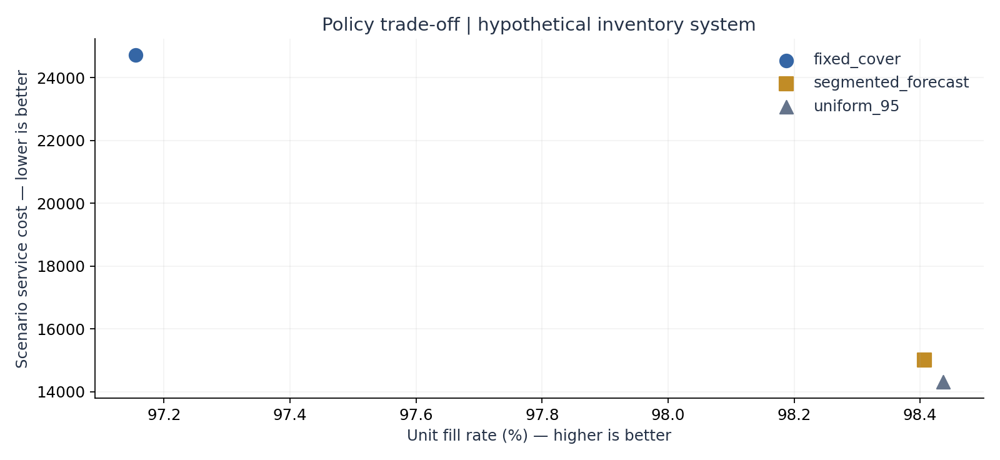
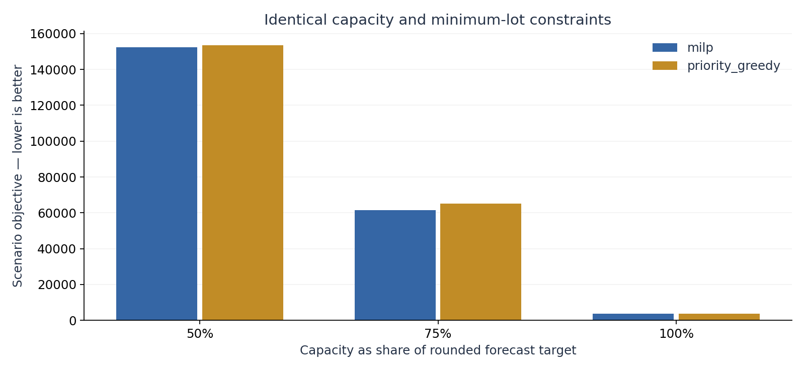

# Reproducible experiment results

Data mode: **independent_synthetic**. All costs are scenario cost units.

Daily panel: 48 SKUs × 420 days. Final 56 days, eight nonoverlapping 7-day origins; 42-day pretest validation.

## 1. Demand forecast

| Model | WAPE ↓ | Bias | MAE ↓ | MASE ↓ |
|---|---:|---:|---:|---:|
| seasonal_naive | 67.82% | -0.86% | 15.057 | 1.003 |
| mean_28 | 59.10% | -3.14% | 13.121 | 0.861 |
| ses | 63.60% | 0.60% | 14.119 | 0.900 |
| croston_sba | 59.17% | -6.00% | 13.136 | 0.865 |
| weekday_blend | 60.21% | -1.75% | 13.367 | 0.870 |
| selected | 61.96% | -1.30% | 13.755 | 0.881 |

Selected-model WAPE relative change vs seasonal naive: **+8.65%** (positive means lower error). This is a descriptive comparison on one panel; no statistical significance or business savings claim.

## 2. Inventory policy simulation

| Policy | Unit fill rate ↑ | Service cost ↓ | Lost units | End stock | End pipeline |
|---|---:|---:|---:|---:|---:|
| fixed_cover | 97.15% | 24,718.8 | 1,698 | 12,270 | 3,755 |
| segmented_forecast | 98.41% | 15,009.5 | 951 | 11,578 | 3,935 |
| uniform_95 | 98.44% | 14,313.1 | 933 | 9,765 | 3,820 |

Costs = end-of-day holding + fixed order costs + lost-sales penalty; purchases and terminal stock value excluded.
Nominal cycle-service parameters are policy inputs, not observed fill-rate guarantees.
See `inventory_sensitivity.csv` for 27 policy/lead-time/shortage-cost scenarios.

## 3. Return-aware print planning and capacity allocation

Annual cohort panel: 72 cohorts; evaluated years [2023, 2024]. Very short annual histories limit generalization. Overage is a proxy for return/inventory exposure; it is not measured returns.

| Policy | Critical fractile | Scenario loss | Overage | Underage |
|---|---:|---:|---:|---:|
| last_year | 50% | 37,294 | 22,688 | 14,606 |
| last_year | 75% | 66,506 | 22,688 | 14,606 |
| last_year | 90% | 154,142 | 22,688 | 14,606 |
| pooled_newsvendor | 50% | 37,594 | 19,713 | 17,881 |
| pooled_newsvendor | 75% | 64,324 | 36,730 | 9,198 |
| pooled_newsvendor | 90% | 100,272 | 62,076 | 4,244 |
| trend_blend | 50% | 39,156 | 24,119 | 15,037 |
| trend_blend | 75% | 69,230 | 24,119 | 15,037 |
| trend_blend | 90% | 159,452 | 24,119 | 15,037 |

The independent capacity experiment plans against forecasts, not future realized demand.
MILP and the feasible greedy comparator share the objective, capacity, lot size and minimum-lot constraints.

| Capacity factor | Policy | Planned units | Objective ↓ | MILP gap |
|---|---|---:|---:|---:|
| 50% | milp | 36,550 | 152,262.5 | 0 |
| 50% | priority_greedy | 36,550 | 153,645.2 | — |
| 75% | milp | 54,850 | 61,347.8 | 0 |
| 75% | priority_greedy | 54,850 | 64,999.6 | — |
| 100% | milp | 72,600 | 3,749.3 | 0 |
| 100% | priority_greedy | 72,600 | 3,749.3 | — |

## Interpretation limits

- This public report uses independently authored synthetic data; no original records or local-only results are included.
- Observed shipments can be constrained by historical availability; unconstrained demand is not identifiable without stockout logs.
- Dense zero-sales dates require ingestion completeness; absent global source dates must be investigated before filling.
- Costs, lead times, opening inventories, capacity and batch constraints are scenario assumptions.
- Forecast selection uses pretest data only; coefficients update from past observations at each test origin.
- Annual cohort mapping may include selection and version-change bias; five annual observations do not support an elaborate forecast.
- These three experiments share schemas but do not form a coupled, deployed ERP or finite-machine scheduling system.
